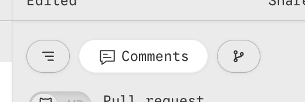
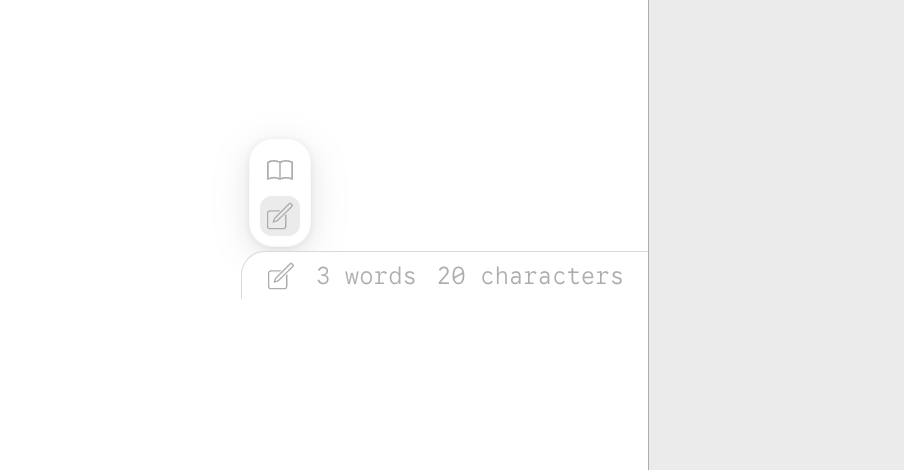
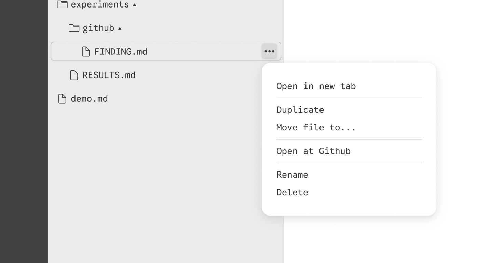

# 🍐 Designs_tasks
# TO redo
1. Change the appernce of the  dropdown menu, use this for design 
  + Add a search in the slash menu when you type "/"

   
2. Change icon for history toggle. Check the design again.

3. This is how it should work. 
   You have this button. You push and dropdown menu appear with selection beetween two mode (read and edit). You choose and the dropdown menu is closing. And the icon will be accorind to selected mode
   Plus fix the position. Now it's flying. 
   
   
  
   
   4. When you hover the file or the folder the three dots appear in the right side of the frame. Then you push it there is dropdown menu appear.  Use this design 
   5. Let's add the spelling cheching. Can you use standart one from big company? Like apple or google
   6. Use optimistic UI for process of loading and edits comments
   7. Let's use toast 

Use this is as a guideline for design. You can find the design for dropdown menus
https://www.figma.com/design/O3BbnNENlU3fMgOGuYqIkh/Red-Letter?node-id=183-849&t=fY2jtLY6YELzAzV4-1