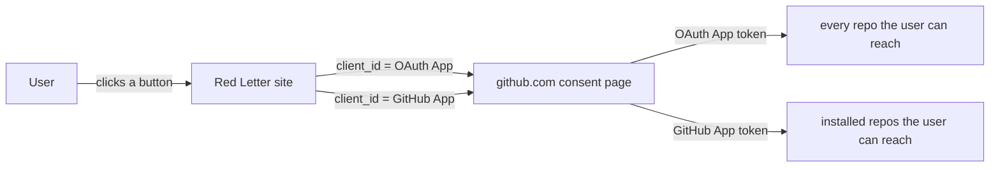
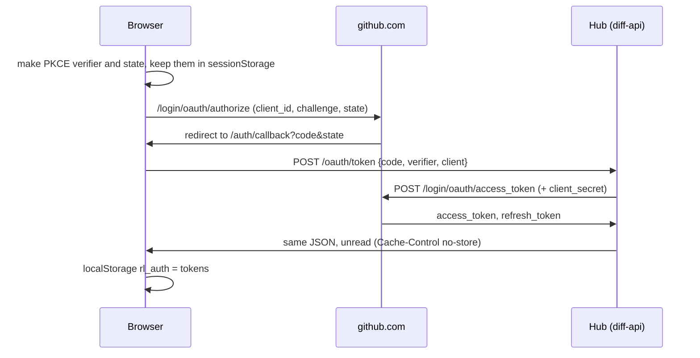
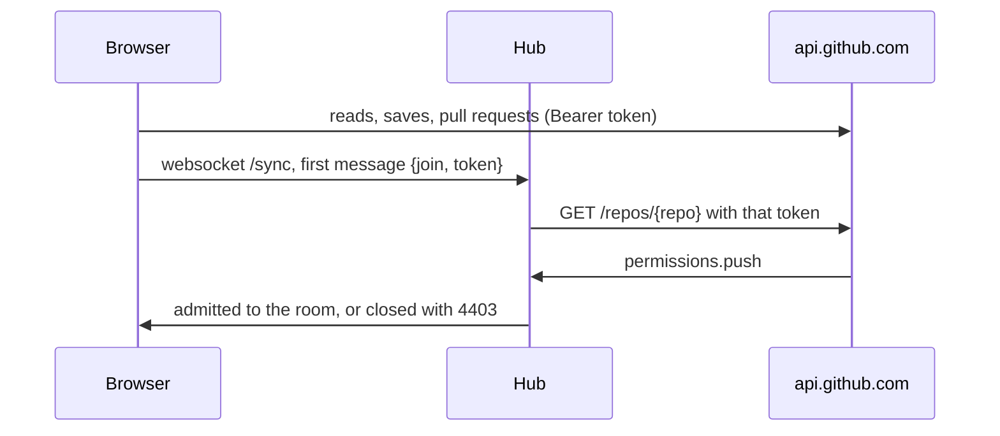

# Sign-in and tokens

How the two sign-in options work, and where a user's GitHub token goes. Code: `web/src/github.ts` (browser), `server/main.go` (`oauth`, `authorized`).

## Two ways in, one authorization server

Both buttons send the user to the same GitHub consent page (`github.com/login/oauth/authorize`); only the `client_id` differs. GitHub is the authorization server in both cases. What differs is what has to be set up on GitHub's side and which repos the token can reach.

| | "Continue with GitHub" (default) | "Use the GitHub App instead" |
|---|---|---|
| GitHub object | classic OAuth App "Red Letter" (`Ov23li…`) | GitHub App `red-letter-diff` (`Iv23li…`) |
| Set up on the repo | nothing; the user approves the app once, for their account | someone with admin rights installs the App on the account or org and picks repos |
| Token reaches | every repo the user can reach (`repo` scope) | repos where the App is installed **and** the user has access |
| Org catch | an org with OAuth app access restrictions has to approve the app first | per-repo install; members still authorize once for their own token |
| Repo without access | GitHub answers 404 | the app shows "Install Red Letter on this repo" (`App.tsx`) |

## Sign-in

The browser can't finish sign-in alone. Turning the one-time `code` into tokens needs the app's `client_secret`, which can't ship in the JS bundle. GitHub's token endpoint also doesn't send CORS headers. So the hub makes that one call and passes GitHub's reply back without reading it.

Refreshing works the same way: `token()` posts the `refresh_token` to `/oauth/refresh` when the access token has less than 5 minutes left, and the hub adds the secret.

## After sign-in

Every GitHub API call goes straight from the browser to `api.github.com`. Saves, reads and pull requests never touch the hub. The token goes to the hub again only to join live sync: the hub admits a tab only if GitHub confirms that token has push access to the repo, so a read-only viewer can't inject edits that a writer's tab would later commit.

The hub caches the answer under `sha256(token + repo)`, in memory, for a short time: a hash, not the token.

## Where the token is

| Place | What | How long |
|---|---|---|
| Browser `localStorage` (`rl_auth`) | access token, refresh token, expiry, kind | until sign-out or a failed refresh |
| Hub, `/oauth/token` and `/oauth/refresh` | GitHub's reply, passed through | one request; not parsed, logged or stored |
| Hub, sync join | access token | one GitHub call; only its hash is cached |
| Hub disk | nothing | |

The weak spot is the browser: any script running on the site can read `localStorage`, so an XSS bug would leak both tokens. That's the cost of having no backend session.
